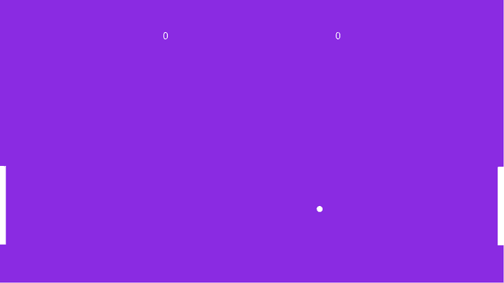
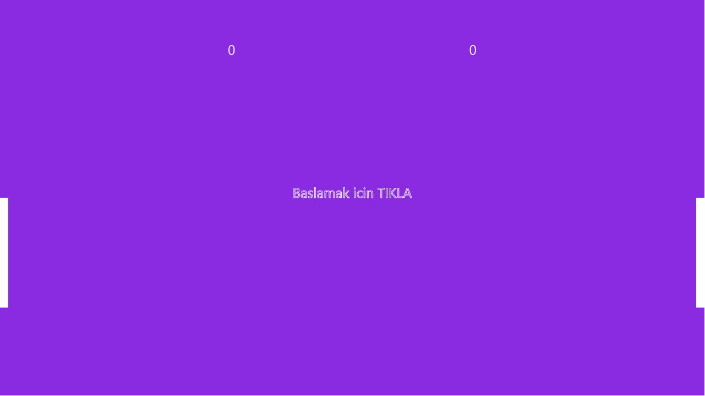
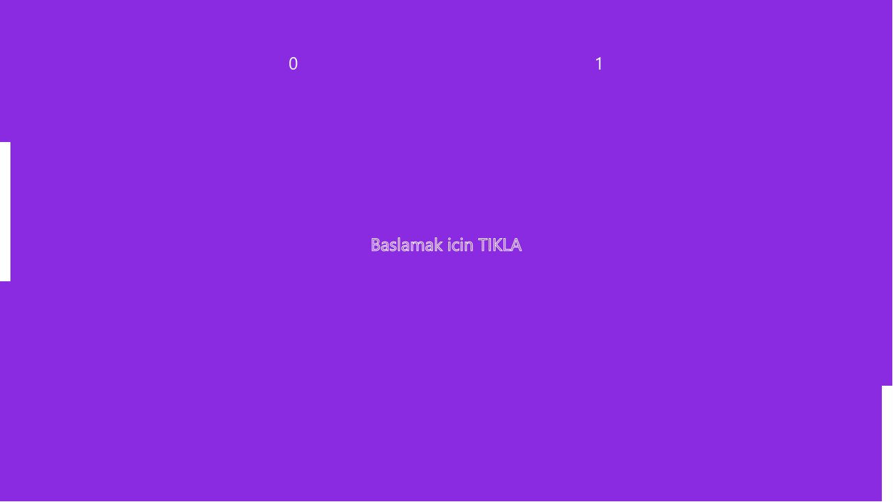

# Masa Tenisi

JavaFX ile yazılmış, bilgisayara karşı oynanan klasik masa tenisi (pong) oyunu.

## Neden?

JavaFX'te Canvas üzerine çizim yapmayı, zamanlayıcıyla bir oyun döngüsü kurmayı ve fareyle kontrol etmeyi tek bir küçük oyunda denemek için yapıldı.

## Oynanış

- Ekrana tıklayınca top ortadan oyuna giriyor.
- Soldaki raket fareyle yukarı aşağı oynatılıyor. Sağdaki raketi bilgisayar oynatıyor: top uzaktayken onu birebir takip ediyor, top kendi kenarına yaklaşınca yavaşlıyor; bu sayede yenilebiliyor.
- Top her raket vuruşunda hızlanıyor. Vuruştan sonra rastgele olarak ya yalnızca yatay yönü ya da hem yatay hem dikey yönü değişiyor.
- Top bir raketin arkasına geçerse karşı tarafa sayı yazılıyor ve oyun yeniden tıklanmayı bekliyor.

## Ekranlar

| Başlangıç | Sayıdan sonra |
|---|---|
|  |  |

## Teknik

| | |
|---|---|
| **Dil** | Java 17 |
| **Arayüz** | JavaFX 17 (Canvas, Timeline) |
| **Kod** | `Oyun/src/main/java/com/example/oyun/Game.java` |
| **Tarih** | Nisan 2022 |

## Çalıştırma

`Game` sınıfı JavaFX kurulu bir IDE'den çalıştırılıyor. `pom.xml` içindeki `javafx:run` ayarı proje şablonundan kalan `HelloApplication` sınıfını gösterdiği için önce `com.example.oyun.Game` olarak değiştirilmesi gerekiyor.
